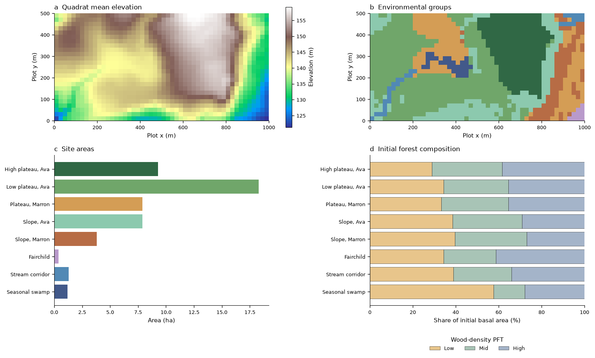
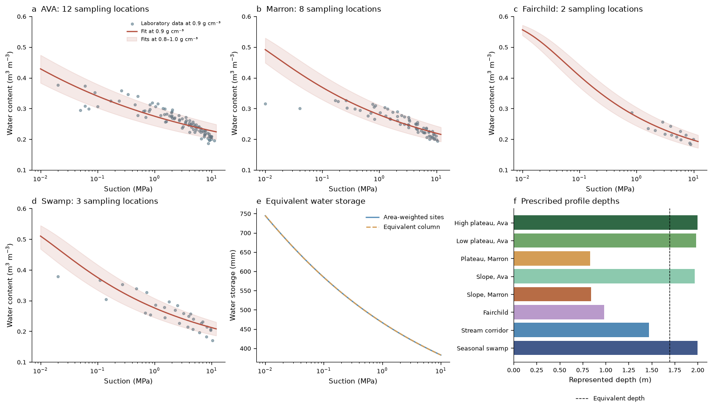

# Methods — Site heterogeneity in the BCI forest plot

## Experimental design

The experiment represents the complete mapped BCI forest plot using environmental groups of
20 × 20 m quadrats. It retains the covariance between the observed terrain, soils and initial
forest composition. The three primary runs share plant parameters, historical weather,
atmospheric CO₂, initial soil water and numerical settings. A uses heterogeneous environments;
B assigns the equivalent environment to the same groups; C places the same input quadrats in
one equivalent site.

Each site supplies common terrain and soil-profile parameters to its patches. Soil water,
soil energy and canopy stores evolve separately in each patch. Fusion and disturbance mix the
affected stores through the model's standard operators. The patch target is 25 per site in the
primary runs; the minimum patch area is a fraction of site area. B − C therefore includes
changes in the total patch budget, absolute-area thresholds and scope of patch interactions.
`S_single_patch_budget` raises C's target to 200 to examine the budget component.

The historical run starts on 1 January 2011 and ends on 1 January 2018. Calendar year 2011 is
treated as adjustment, and annual contrasts are averaged over 2012–2017. The primary parameters
are inherited from the preceding examples. The later 2015 census and field water-potential
records are used as diagnostics, rather than targets for selecting these parameters.

## Spatial assignment

The elevation panel shows quadrat means derived from the survey grid. The grouping covers the
complete plot, and its area fractions supply the polygon aggregation weights. The composition
panel uses each site's observed initial basal area, calculated from the selected diameter of
each eligible tree. Colors denote the same sites and wood-density PFTs throughout the example.
The source files and acquisition steps are listed in [Data sources and access](README.md#data-sources-and-access).

The elevation grid and tree tables are from the [2019 BCI census archive](https://doi.org/10.15146/5xcp-0d46).
The habitat classification follows [Harms et al. (2001)](https://doi.org/10.1111/j.1365-2745.2001.00615.x),
using the observed table pinned in `sources.json`. The soil map is distributed with
[Kupers et al. (2019)](https://doi.org/10.1038/s41597-019-0072-z).

Quadrats are assigned in this order: observed swamp; observed stream; dominant Fairchild soil;
slopes split between Ava and Marron; other Marron; high and low Ava plateaus. The resulting
groups may contain disconnected quadrats. Original young-forest and mixed-habitat labels are
retained in the assignment table. For those two labels only, slope ≥7° defines the slope class;
otherwise elevation ≥152 m defines high plateau, following the habitat thresholds.

For each quadrat, elevation and soil fractions are integrated over the 5 m grid with tensor-product
trapezoidal weights. The classification slope averages the four corner-triangle slopes.
The corner-plane gradient defines aspect. Group slope and aspect come from the normalized mean
of upward surface normals. Swamp membership follows the observed habitat quadrat; mapped swamp
outside it is reassigned to Marron, following the correction in the Kupers processing workflow.
The containing quadrat is the spatial unit for this overlay. The model reads these representative
site parameters, rather than the elevation grid itself. Opposing slope aspects can partly cancel
in the surface-normal average; a group's representative slope need not equal the mean of its
quadrat classification slopes. No flow direction or contributing area is derived from the grid.

## Soil profiles and equivalence

Laboratory points are shown with the fit at the assumed bulk density and an envelope spanning
the alternative density fits. This envelope represents the density assumptions, not a statistical
confidence interval. The lower panels connect the fitted retention to storage equivalence and
the prescribed profile depths.

The [retention dataset](https://doi.org/10.5061/dryad.1023m1d) provides laboratory water content and
potential at mapped sampling locations. Gravimetric water content is converted to volumetric
content using bulk density 0.9 g cm⁻³, with alternative fits at 0.8 and 1.0. These densities are
assumptions inherited from the prior BCI setup. Residual and saturated water contents are fixed
at 0.10 and 0.60, respectively. Each sampled location has equal total weight in its soil-class fit.
Measurements with potential ≤−0.05 MPa constrain the van Genuchten curve:

$$\theta(\psi)=\theta_r+(\theta_s-\theta_r)
 [1+(\alpha |\psi|10^6/9806.65)^n]^{-(1-1/n)}.$$

Potential is in MPa and α in m⁻¹. Fits bound α to 0.02–200 m⁻¹ and n to 1.03–2.5.
The common saturated conductivity is 10⁻⁵ m s⁻¹, inherited from Example 04. Laboratory retention
data constrain the dry-range water-retention response; conductivity, porosity and bulk density
remain prescribed. Each fitted retention curve is applied throughout its column.

The source-soil depths are **scenario parameters**: Ava 2.0 m, Marron 0.8 m, Fairchild 1.0 m and
swamp 2.0 m. They specify represented storage and root access; the dataset does not contain a
measured full-depth profile for each model site. For soil fractions fᵢc and source depths Zc,
the site depth is Zᵢ = Σc fᵢc Zc. Its retention curve is fitted to the corresponding
depth-weighted water content, Σc fᵢc Zc θc(ψ) / Zᵢ.

The equivalent environment uses site area fractions aᵢ:

$$Z_{eq}=\sum_i a_i Z_i,\qquad
 S_{target}(\psi)=\sum_i a_i Z_i\theta_i(\psi),\qquad
 \theta_{eq}(\psi)\simeq S_{target}(\psi)/Z_{eq}.$$

The fit uses 120 log-spaced suctions from 0.01 to 10 MPa. It preserves total soil volume,
residual and saturated storage, and the initial store at uniform θ=0.42. Interior-range
storage residuals are written to `data/equivalent_storage.csv`. Equivalent elevation is the
area mean; slope and aspect use the surface-normal average over the complete plot.

Each column has layer bottoms at fractions [0.025, 0.05, 0.10, 0.20, 0.35, 0.50, 0.75, 1.0]
of its depth. Deep temperature is 298.65 K; the thermal anchor is 0.875 Z + 1.973/√2 m, following
the inherited thermal setup. The primary bottom boundary is free drainage.
`S_wetland_aquifer` places a water table at the swamp column's base.

`S_equal_depth` assigns the area-mean depth to every A site and adjusts its layer depths and
thermal anchor with the same rules. Terrain, retention parameters, site areas and vegetation
are retained. Total soil volume and initial water are conserved. The full storage-versus-potential
curve can change. This sensitivity was introduced after examining the primary runs; it measures
their dependence on depth allocation, including the associated layer and thermal geometry.
It is not an additive decomposition of the environmental response.

## Forest representation

Native R exports preserve the published tree-table fields. Living records with status A,
DBH ≥1 cm and valid plot coordinates initialize the forest. Each tree enters its original
quadrat; exact matching DBH/PFT combinations are combined without diameter binning. Patch area
is 400 m² and cohort density is the represented tree count divided by that area.

Species are assigned to the three wood-density classes of Example 03, with boundaries 0.42
and 0.58 g cm⁻³. Missing lookup codes use the wood density and taxonomic resolution supplied in
the same archive's species table. The model uses PFT wood densities [0.36, 0.50, 0.68] g cm⁻³.
The PFT file retains Example 05's traits, mortality, recruitment and allocation parameters;
the BCI light/water phenology cues from Example 02 are transferred to all three PFTs.
`S_no_cue` retains background turnover and omits those cues.

The census `dbh` describes the selected stem, while its original `ba` and `agb` fields sum
all stems on a tree. This initialization represents one selected diameter per eligible tree.
For a common-estimator comparison, census biomass is recalculated with the model's PFT density,
BCI height curve and [Chave et al. (2014)](https://doi.org/10.1111/gcb.12629) allometry:

$$H=\exp[0.8898+0.7908\log D-0.04923(\log D)^2],\qquad
 AGB_C=0.03365(\rho D^2 H)^{0.976}.$$

D is in cm, H in m and individual AGB in kg C. The carbon fraction is 0.5. Results retain both
the common-estimator comparison and the archive's original all-stem biomass estimate.
The latter differs in stem representation, traits and allometry. Agreement under the common
estimator tests the represented stand structure rather than independently measuring biomass.

The nominal 2010 census is assigned to January 2011. The comparison uses the July 2015 model
snapshot and the nominal 2015 census. Actual measurement-date ranges and medians are generated
in `data/census_round_metadata.json`; this is a census-round comparison with unequal exact
tree-level intervals.

## Forcing and active processes

The hourly ERA5-Land cell and its end-stamp convention are inherited from Example 05; historical
weather is read without recycling. The grid elevation is 72.97434998 m. A lapse rate of
0.0065 K m⁻¹ adjusts temperature to each site's elevation, with the model's corresponding
humidity, pressure and longwave adjustments. Direct beam is projected onto each representative
slope. The CO₂ series is the repository's CMIP7 global annual forcing.

Fast biophysics, canopy interception, soil water and heat, soil carbon, daily carbon allocation,
phenology cues, trait plasticity, mortality, recruitment, disturbance, and cohort/patch
restructuring are active. Leaf boundary-layer CO₂ resistance and thermal acclimation retain
the inherited disabled settings. The fast solver is ESDIRK2 with a 300 s outer step; the slow
step is daily. Soil carbon uses the inherited steady-input initialization. Resolved module flags,
bottom boundaries and layer geometry are verified from the model-written parameter records
and diagnostics.

Lateral water transport, intersite seed dispersal, diffuse slope corrections and terrain
shading are absent. The equivalent column matches a storage curve; nonlinear hydraulic,
rooting and canopy responses determine whether its fluxes match the heterogeneous polygon.

## Stand aggregation and diagnostics

Monthly AGB and LAI trajectories are the primary stand comparison. The full historical period
shows the adjustment, seasonal variation and divergence between A and B; period statistics use
the years after adjustment. Common-date comparisons give the magnitude and composition of the
stand at a specified time. Monthly polygon flux curves are means of the daily rates within each
month, whereas annual flux totals integrate those rates over their time bounds.

For within-site patch fraction bᵢⱼ, cohort abundance nᵢⱼₖ and per-plant biomass Bᵢⱼₖ,
site AGB is Σⱼ bᵢⱼ Σₖ nᵢⱼₖ Bᵢⱼₖ. LAI uses per-plant leaf area in place of biomass.
PFT composition is each PFT's contribution divided by site AGB. These are reconstructed from
cohort output and owning patch areas, and checked against the model's polygon totals after
applying site fractions aᵢ. AGB and LAI in the main figure include all modeled cohorts; the
census diagnostics apply DBH ≥1 cm on both sides.

Daily site means use time-averaged patch areas from the output. Polygon flux totals integrate
daily means over their time bounds. Field-water comparisons interpolate each site's daily mean
profile to the recorded sample depth and join it to the observation date. Samples flagged as
outliers or lacking depth are excluded. Site means and field point samples have different
spatial and temporal support; their paired residuals and site-specific errors are retained.

Cross-site variation reflects both initial vegetation and subsequent environmental responses.
Annual ranges in the contrast figure describe variation among simulated years. They are not
confidence intervals or replicated experimental errors. The depth sensitivity tests a prescribed
property, so the reported contrast magnitude is conditional on the selected profile depths.

Paired A–B diagnostics retain the same site IDs and verify identical initial cohort aggregates.
Daily GPP, ET, AGB and LAI contrasts use 100 × (mean A / mean B − 1) over the analysis period.
Their absolute values are also retained. A site's contribution to the polygon relative difference
is 100 aᵢ (mean Aᵢ − mean Bᵢ) / Σⱼ aⱼ mean Bⱼ. Water-potential differences are in MPa.
Monthly composition contrasts subtract each PFT's AGB fraction in B from its fraction in A and
report percentage points. Both simulations are reconstructed from patch and cohort states and
checked against their polygon AGB, LAI, density and basal area. The model-wide comparisons include
all cohorts; the census comparisons apply the same diameter cutoff to the observed and modeled
stands.

## Hourly process window

An A restart at the start of the dry-season window supplies both outer-step experiments. The
two runs use the same forcing and initial state, with outer steps of 300 and 150 s and common
one-hour output intervals. The window covers 20–30 April 2016 UTC. Soil potential and temperature
are interpolated to 0.15 m using each site's own layer centers; polygon GPP and ET are hourly
means. `analyze_hourly.py` checks the restart-file hashes and interval alignment before comparing
the runs. The hourly window resolves transient responses; the full historical trajectories and
multiyear contrasts remain the main results.
