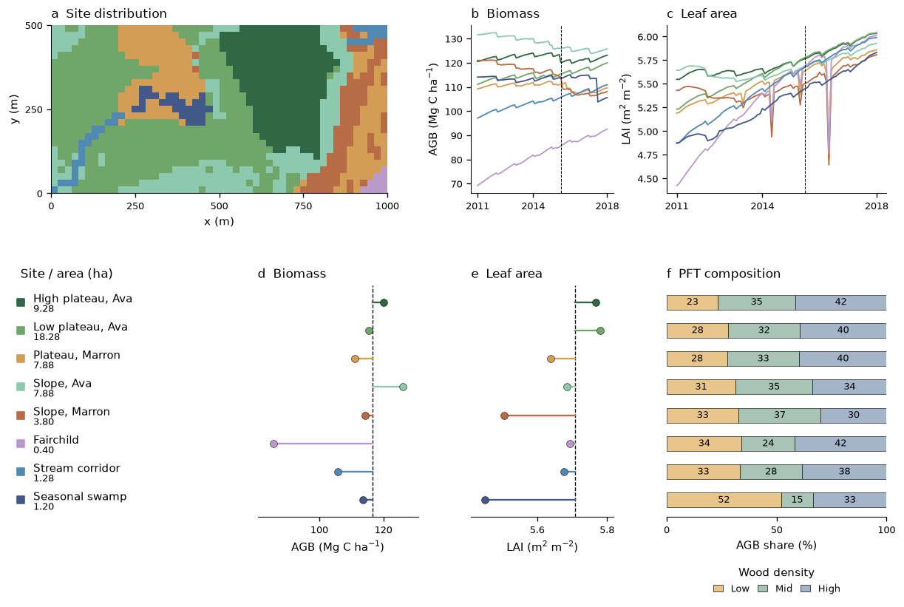
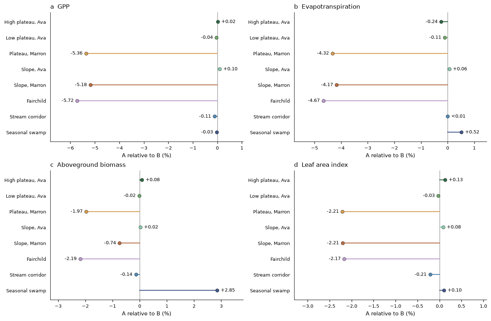
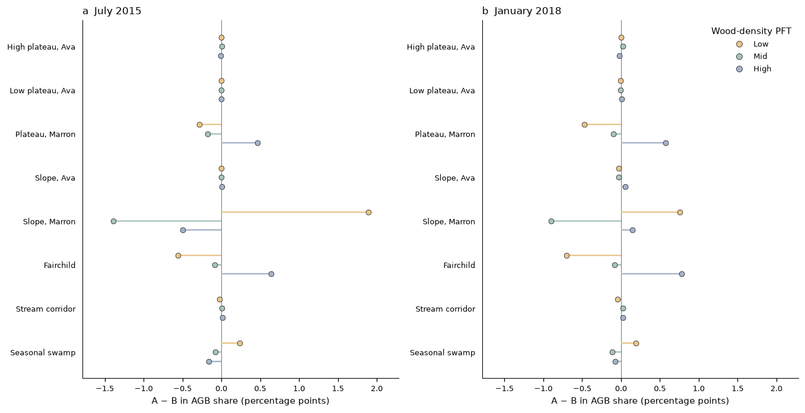

# Example 07 — Site heterogeneity within a polygon

The Barro Colorado Island forest plot is represented by sites with different terrain, soil
profiles and initial vegetation. Three simulations separate the response to environmental
heterogeneity from the effects of grouping forest patches into sites. All retain the inherited
BCI plant parameters from Examples 02–05. Each site groups quadrats with similar habitat and soil;
the groups cover the complete plot and can include disconnected patches.



The figure combines the site map, monthly stand trajectories and a common-date comparison of
aboveground biomass (AGB), leaf area index (LAI) and plant functional type (PFT) composition.
The lower panels show 1 July 2015; dashed lines mark the polygon area-weighted means.
All modeled cohorts are included. The full captions and numerical summaries are generated in
`results/RESULTS.md`.
Figures are exported as PNG, PDF and editable SVG; their input tables remain in `results/`.

## Experiment

| Design | Environment | Forest initialization |
|---|---|---|
| A: heterogeneous | Each site has its own elevation, slope, aspect and soil profile | Each mapped tree remains in its original quadrat and environmental group |
| B: uniform, multiple sites | A common area-equivalent environment in the same sites | Identical to A |
| C: uniform, one site | One site with the equivalent environment | The same input quadrats, with polygon area weights |

A − B measures the response to the specified environmental differences. B − C measures the
effect of site grouping, including the scope and capacity of patch restructuring. C retains
separate patches and their dynamic water stores. The equivalent soil profile is fitted to
area-weighted water storage as a function of potential.

The depth sensitivity assigns every A site the same area-mean depth while retaining its terrain,
retention curve and initial vegetation. The source-soil depths are prescribed scenarios;
they are not inferred from the elevation grid or measured separately for each site. Additional
runs change the swamp bottom boundary, phenology cues, or the single site's patch budget. [Methods](METHODS.md) specifies the site
selection, equivalence calculation, parameter sources and interpretation of these contrasts.

<!-- results:start -->

For 2012–2017, A has 1.281% lower GPP and 1.095% lower evapotranspiration than B. The B − C differences are +0.047% for GPP and -0.003% for evapotranspiration. Across the full A − C comparison, the differences are -1.235% and -1.098%. Assigning every A site the area-mean depth (1.695 m) changes its differences from B to -0.020% and -0.019%, respectively. Thus the simulated flux contrast depends strongly on the prescribed depth allocation.

<!-- results:end -->

## Paired site responses



A relative to B, calculated as 100 × (mean A / mean B − 1) from daily values over 2012–2017.
Colors identify the same sites as the map. Each pair starts from the same observed forest;
the contrast measures the response to the assigned terrain and soil profile, including the
subsequent forest dynamics. AGB and LAI include all modeled cohorts. Absolute values and each
site's contribution to the polygon difference are exported in `results/AB_site_summary.csv`.



A minus B in each PFT's share of site AGB, in percentage points. The colors retain the low-,
mid- and high-wood-density classes of the overview; their three differences sum to zero at
each site. The two panels compare July 2015 with the final saved month. The monthly source
table is `results/AB_site_pft_monthly.csv.gz`. These comparisons separate environmental
responses from the initial differences among site forests.

## Reproduce

Run these commands from the repository root. Build the Python library using the
[dev preset](../../docs/building.md), activate the repository's Python environment and install
native R for reading the published census tables. The Python dependencies are those in
[`environment.yml`](../../environment.yml). Select a library explicitly if it is outside
`build-dev/`.

Download the files listed in [`sources.json`](sources.json) into one directory. The census and
elevation come from [Condit et al.](https://doi.org/10.15146/5xcp-0d46), the soil map from
[Kupers et al.](https://doi.org/10.6084/m9.figshare.7611005.v1), and the retention and field-water
tables from [Kupers et al.](https://doi.org/10.5061/dryad.1023m1d). The script verifies their
checksums and downloads the pinned habitat table if it is absent. If a data service requires a
browser download, save the named file in the same directory and rerun the command.

```sh
python examples/example07_site_heterogeneity/fetch_data.py \
  --copy-from "$BCI_DOWNLOADS" --era5-archive "$ERA5LAND_ARCHIVE"
python examples/example07_site_heterogeneity/prepare_input.py
python examples/example07_site_heterogeneity/prepare_validation.py
python examples/example07_site_heterogeneity/verify_design.py
```

`BCI_DOWNLOADS` is the directory holding those public downloads. `ERA5LAND_ARCHIVE` is the
processed archive used by Example 05. Alternatively pass `--forcing` with Example 05's
`bci_era5land_2003-2022.nc`. The forcing is extracted by the repository's
[`make_forcing_file.py`](../../scripts/prepare_input/era5/make_forcing_file.py); its README
describes downloading ERA5-Land from CDS when a processed archive is unavailable.

```sh
for scenario in A_heterogeneous B_uniform_multisite C_uniform_single S_equal_depth; do
  python examples/example07_site_heterogeneity/run_example.py --scenario "$scenario"
done
python examples/example07_site_heterogeneity/analyze_results.py --available
python examples/example07_site_heterogeneity/analyze_stands.py
python examples/example07_site_heterogeneity/plot_results.py
```

The run script also accepts `S_wetland_aquifer`, `S_no_cue` and `S_single_patch_budget`.
Use `--library`, `--threads`, `--days`, `--dt`, or `--restart` for controlled checks; give each
new run a distinct `--suffix`. Completed output is retained. A short run checks execution but
does not supply the historical period required by the result analysis. The launcher records
the library and configuration hashes, and saves monthly cohort states with their patch and site
membership. `analyze_results.py` checks the resolved process switches and site properties from
the model's output. Site soils are specified explicitly in the generated `[[sites]]`
tables under `configs/`; the soil-map runtime mode is not used.

Data, generated site configurations, model output, result tables and full-size figures are
excluded from version control. The compact README previews are tracked. To refresh this
README's result paragraph after a full run, use
`python examples/example07_site_heterogeneity/plot_results.py --update-readme`.

## What to inspect

| Output | Question |
|---|---|
| `figures/01_site_stands.*` | How do site AGB, LAI and PFT composition differ? |
| `figures/02_representation_contrasts.*` | How do A − B, B − C, A − C and equal depth change polygon totals? |
| `figures/03_site_environment.*` | How do elevation lapse, direct beam and soil water vary among sites? |
| `figures/04_soil_profiles.*` | What profiles are assigned, and how is the equivalent column constructed? |
| `figures/05_soil_water.*`, `06_soil_potential.*` | How do seasonal profiles differ on each site's own soil layers? |
| `figures/07_site_responses.*` | How does each site respond to its own environment relative to the equivalent one? |
| `figures/08_site_composition.*` | How does the environment change each site's PFT biomass shares? |
| `results/A_site_stand_closure.csv`, `B_site_stand_closure.csv` | Do patch/cohort reconstructions recover the polygon stand totals? |
| `results/census_2015_comparison.csv`, `A_site_pft_census_2015.csv` | How do tree density, basal area and biomass compare with the census? |
| `results/field_swp_metrics_by_site.csv` | How do modeled potentials compare with field samples? |
| `results/module_audit.csv`, `environment_runtime_audit.csv`, `run_audit.json` | Which processes and site properties were actually used, and how do the numerical budgets close? |

The model exchanges neither water nor seeds laterally between sites. Terrain corrections apply
to direct-beam radiation; diffuse slope corrections and topographic shading are absent. These
are independent columns with site-local forest dynamics within one polygon.
