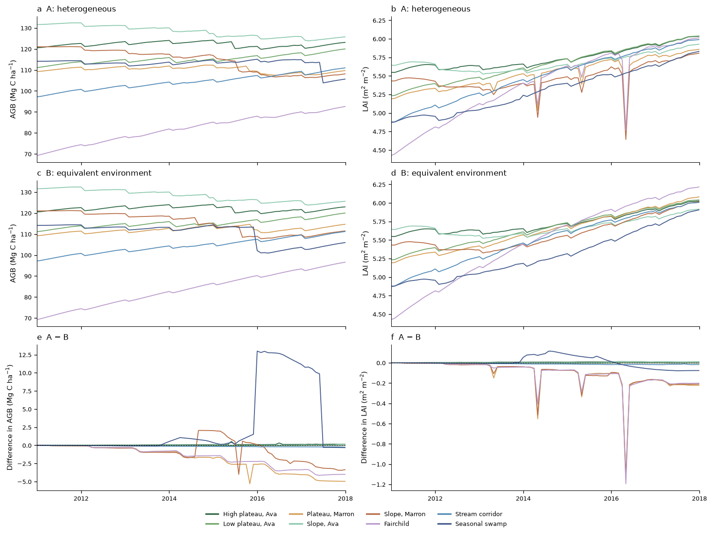
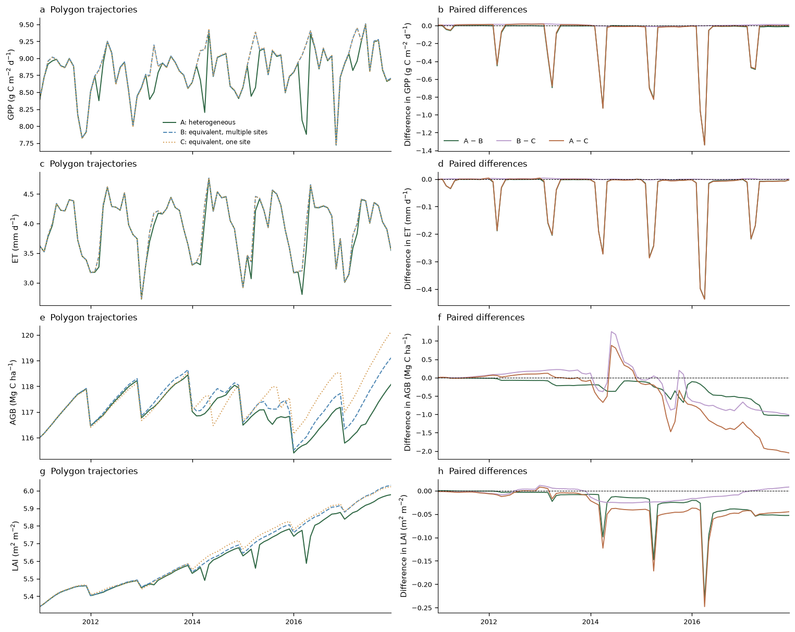
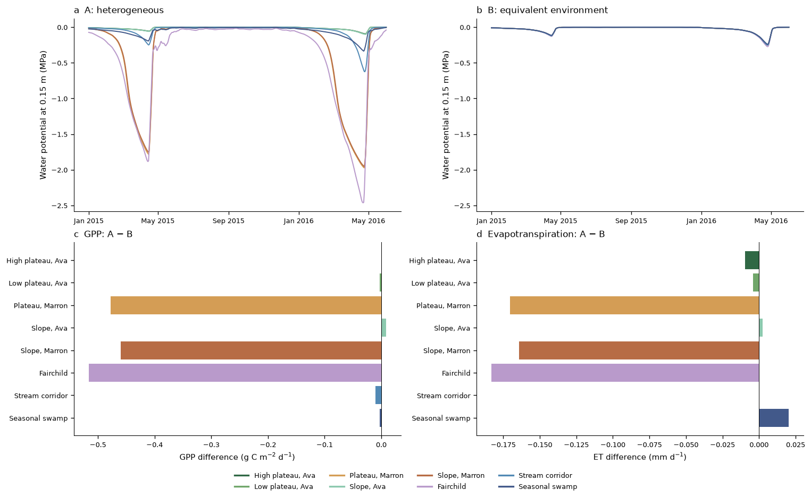
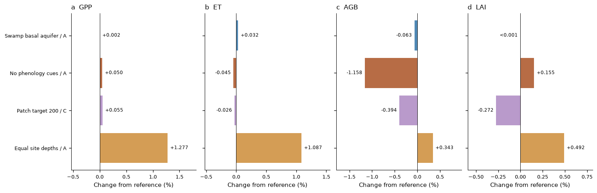
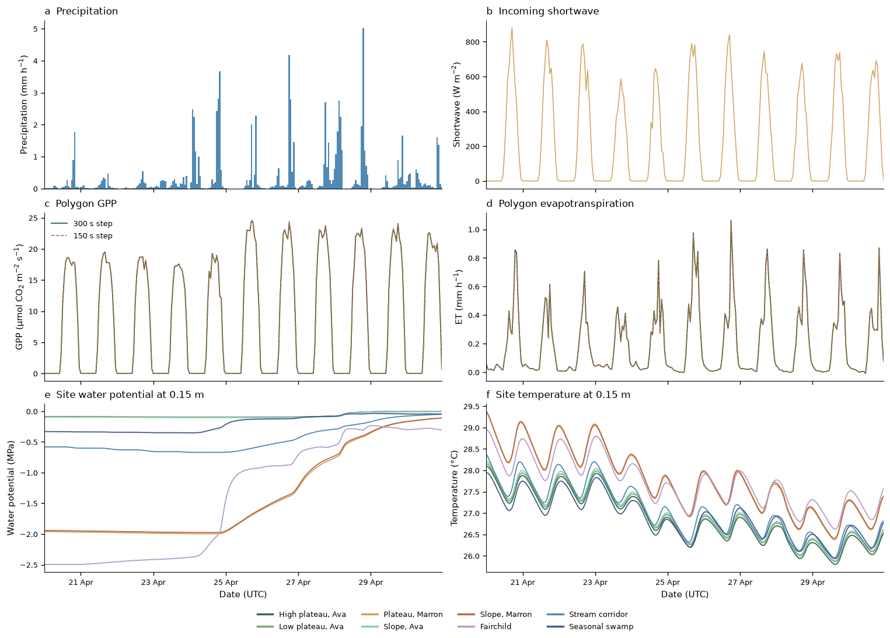

# Example 07 — Site heterogeneity within a polygon

The Barro Colorado Island forest plot is represented by sites with different terrain, soil
profiles and initial vegetation. Three simulations separate the response to environmental
heterogeneity from the effects of grouping forest patches into sites. All retain the inherited
BCI plant parameters from Examples 02–05. Each site groups quadrats with similar habitat and soil;
the groups cover the complete plot and can include disconnected patches.

The main comparisons follow the complete historical trajectories. Period means quantify their
integrated differences, and common-date snapshots describe stand structure at a specified time.
[Methods](METHODS.md) explains the spatial design, soil equivalence and active processes;
[Data sources and access](#data-sources-and-access) lists the original datasets and acquisition steps.

## Experiment

| Design | Environment | Forest initialization |
|---|---|---|
| A: heterogeneous | Each site has its own elevation, slope, aspect and soil profile | Each mapped tree remains in its original quadrat and environmental group |
| B: uniform, multiple sites | A common area-equivalent environment in the same sites | Identical to A |
| C: uniform, one site | One site with the equivalent environment | The same input quadrats, with polygon area weights |

A − B measures the response to the specified environmental differences. B − C measures the
effect of site grouping, including the scope and capacity of patch restructuring. C retains
separate patches and their dynamic water stores. The equivalent soil profile is fitted to
area-weighted water storage as a function of potential.

The depth sensitivity assigns every A site the same area-mean depth while retaining its terrain,
retention curve and initial vegetation. The source-soil depths are prescribed scenarios;
they are not inferred from the elevation grid or measured separately for each site. Additional
runs change the swamp bottom boundary, phenology cues, or the single site's patch budget. [Methods](METHODS.md) specifies the site
selection, equivalence calculation, parameter sources and interpretation of these contrasts.

## Continuous site and polygon comparisons



Monthly aboveground biomass (AGB) and leaf area index (LAI) are reconstructed from cohort states
and their owning patch areas, including all modeled cohorts. A and B start from identical site
forests. Their absolute trajectories use matching scales; the lower panels resolve their paired
differences through time. Site colors are consistent throughout the example. The adjustment
year is displayed and excluded from period-mean statistics. The paired source table is
`results/AB_site_stand_monthly.csv`.



Monthly means of daily polygon GPP, evapotranspiration (ET), AGB and LAI, together with their
absolute differences. GPP and ET are mean daily rates within each month. The contrasts follow
seasonal responses and longer-term changes over the full run; the source table is
`results/polygon_monthly.csv`.

## Environmental responses and period means



Water potential at 0.15 m is shown on the same scale for A and B, using trailing seven-day means
over the illustrated dry seasons. The lower panels quantify the absolute mean daily GPP and ET
differences over the complete analysis period. The full-period stand and polygon trajectories
above place this seasonal window in context.

<!-- results:start -->

For 2012–2017, A has 1.281% lower GPP and 1.095% lower evapotranspiration than B. The B − C differences are +0.047% for GPP and -0.003% for evapotranspiration. Across the full A − C comparison, the differences are -1.235% and -1.098%. Assigning every A site the area-mean depth (1.695 m) changes its differences from B to -0.020% and -0.019%, respectively. Thus the simulated flux contrast depends strongly on the prescribed depth allocation.

<!-- results:end -->


A relative to B, calculated as 100 × (mean A / mean B − 1) from daily values over 2012–2017.
Colors identify the same sites as the map. Each pair starts from the same observed forest;
the contrast measures the response to the assigned terrain and soil profile, including the
subsequent forest dynamics. AGB and LAI include all modeled cohorts. Absolute values and each
site's contribution to the polygon difference are exported in `results/AB_site_summary.csv`.

## Stand structure at common dates


The lower panels quantify site AGB, LAI and plant functional type (PFT) biomass shares on
1 July 2015. Dashed lines mark the polygon area-weighted means. The upper panels place that
snapshot within the mapped sites and their monthly trajectories. All modeled cohorts are
included. These values describe the stand at the selected date; the continuous comparisons
above show how it developed.


A minus B in each PFT's share of site AGB, in percentage points. The colors retain the low-,
mid- and high-wood-density classes of the overview; their three differences sum to zero at
each site. The two panels compare July 2015 with the final saved month. The monthly source
table is `results/AB_site_pft_monthly.csv.gz`. These comparisons separate environmental
responses from the initial differences among site forests.

## Sensitivity and hourly processes



Changes in the 2012–2017 means relative to the reference named in each row. The aquifer,
phenology-cue and equal-depth scenarios use A as reference; the larger single-site patch budget
uses C. These contrasts examine distinct assumptions and are not additive contributions.
The numerical values are in `results/sensitivity_summary.csv`.



Hourly processes during 20–30 April 2016 UTC. The two A runs begin from the same restart state
and use 300 and 150 s outer steps with identical hourly reporting intervals. GPP and ET are
polygon means. Soil potential and temperature are site means interpolated to 0.15 m, shown for
the 300 s run. This window resolves transient responses alongside the continuous historical
comparison. Its source table and provenance are `results/hourly_window.csv` and
`results/hourly_provenance.json`.

## Data sources and access

| Input and role | Original source | Files and acquisition |
|---|---|---|
| Mapped tree census, species and survey elevation; forest initialization and terrain | [Condit et al. (2019), Dryad](https://doi.org/10.15146/5xcp-0d46) | `bci.tree.zip`, `bci.spptable.rdata`, `BCIelev.tsv`; direct file links and SHA-256 checksums are in [`sources.json`](sources.json). |
| Quadrat habitat labels; environmental grouping | [ForestGEO BCI habitat table, pinned revision](https://raw.githubusercontent.com/forestgeo/bciex/9083e3b5f7c913db45df12f265b93528f0d1a679/data-raw/from_suzanne_lao/bcifiles/habitat.txt) | Saved as `bci_habitat_observed.tsv`; fetched automatically and checksum-verified. |
| Soil-class map; site soil fractions | [Kupers et al., Figshare v1](https://doi.org/10.6084/m9.figshare.7611005.v1) | Download `Kupers_et_al.zip` in a browser and pass its directory with `--copy-from`. |
| Laboratory retention measurements; hydraulic fits | [Kupers et al., Dryad](https://doi.org/10.5061/dryad.1023m1d) | `BCI_retention_curves.txt`; its original readme is available beside the file on Dryad. |
| Field soil-water content and potential; observation diagnostics | [Kupers et al., Dryad](https://doi.org/10.5061/dryad.1023m1d) | `BCI_SWP_SWC.txt`; its original readme defines the sampling fields and flags. |
| Historical hourly weather; common forcing before site corrections | [ERA5-Land, Copernicus CDS](https://cds.climate.copernicus.eu/datasets/reanalysis-era5-land?tab=overview) | Reuse Example 05's `bci_era5land_2003-2022.nc`, or follow the [ERA5-Land acquisition and processing guide](../../scripts/prepare_input/era5/README.md). |
| Atmospheric CO₂; common annual concentration | [CMIP7 series and provenance](../../data/co2/co2_cmip7_global_annual_1000-2022.txt) | Already included in the repository; original input URLs and conversion commands are in [`make_co2_file.py`](../../scripts/prepare_input/co2/make_co2_file.py). |
| Wood-density mapping and plant parameters | [Example 03](../example03_demography/README.md), [Example 02](../example02_canopy_phenology/README.md), [Example 05](../example05_forest_regeneration/README.md) | The species lookup is already in the repository; the inherited PFT files are included here. |

The census, elevation, habitat, soil map and water measurements describe the BCI plot. ERA5-Land
is gridded reanalysis, not weather measured separately at each site. Profile depth, bulk density,
saturated conductivity and the bottom boundary are specified in [Methods](METHODS.md#soil-profiles-and-equivalence);
they are not supplied as measured full-depth profiles for each environmental group.

Download the named files into one directory, retaining their filenames. `fetch_data.py` copies
local files, fetches supported missing files and checks their hashes. It uses native R to export
the two census rounds without changing factor levels or missing values. Downloaded inputs and
derived files are recorded in `data/source_manifest.json`. If automatic access is blocked by a
data service, save the file through its original data page and rerun with `--copy-from`.

## Reproduce

Run these commands from the repository root. Build the Python library using the
[dev preset](../../docs/building.md), activate the repository's Python environment and install
native R for reading the published census tables. The Python dependencies are those in
[`environment.yml`](../../environment.yml). Select a library explicitly if it is outside
`build-dev/`.

Prepare the files listed in [Data sources and access](#data-sources-and-access), then run:

```sh
python examples/example07_site_heterogeneity/fetch_data.py \
  --copy-from "$BCI_DOWNLOADS" --era5-archive "$ERA5LAND_ARCHIVE"
python examples/example07_site_heterogeneity/prepare_input.py
python examples/example07_site_heterogeneity/prepare_validation.py
python examples/example07_site_heterogeneity/verify_design.py
```

`BCI_DOWNLOADS` is the directory holding those public downloads. `ERA5LAND_ARCHIVE` is the
processed archive used by Example 05. Alternatively pass `--forcing` with Example 05's
`bci_era5land_2003-2022.nc`. The forcing is extracted by the repository's
[`make_forcing_file.py`](../../scripts/prepare_input/era5/make_forcing_file.py); its README
describes downloading ERA5-Land from CDS when a processed archive is unavailable.

```sh
for scenario in A_heterogeneous B_uniform_multisite C_uniform_single \
  S_equal_depth S_wetland_aquifer S_no_cue S_single_patch_budget; do
  python examples/example07_site_heterogeneity/run_example.py --scenario "$scenario"
done
python examples/example07_site_heterogeneity/analyze_results.py --available
python examples/example07_site_heterogeneity/analyze_stands.py
python examples/example07_site_heterogeneity/plot_results.py
```

The hourly comparison is an additional restart experiment. After the historical A run, advance
its January restart to the window start, then launch both outer steps from that same state:

```sh
example=examples/example07_site_heterogeneity
python "$example/run_example.py" --scenario A_heterogeneous --suffix window_lead \
  --start 2016-01-01 --end 2016-04-20 \
  --restart "$example/output/A_heterogeneous/A_heterogeneous-S-20160101000000.nc"
for dt in 300 150; do
  python "$example/run_example.py" --scenario A_heterogeneous --suffix "window_dt${dt}" \
    --start 2016-04-20 --end 2016-05-01 --dt "$dt" --io-config "$example/io_window.toml" \
    --restart "$example/output/A_heterogeneous_window_lead/A_heterogeneous_window_lead-S-20160420000000.nc"
done
python "$example/analyze_hourly.py"
python "$example/plot_results.py" --update-readme
```

Use `--library`, `--threads`, `--days`, `--dt`, or `--restart` for controlled checks; give each
new run a distinct `--suffix`. Completed output is retained. A short run checks execution but
does not supply the historical period required by the result analysis. The launcher records
the library and configuration hashes, and saves monthly cohort states with their patch and site
membership. `analyze_results.py` checks the resolved process switches and site properties from
the model's output. Site soils are specified explicitly in the generated `[[sites]]`
tables under `configs/`; the soil-map runtime mode is not used.

Data, generated site configurations, model output, result tables and full-size figures are
excluded from version control. Compact document previews are tracked. Figures are exported as
PNG, PDF and editable SVG; complete captions and numerical summaries are generated in
`results/RESULTS.md`. To refresh this
README's result paragraph after a full run, use
`python examples/example07_site_heterogeneity/plot_results.py --update-readme`.

## What to inspect

| Output | Question |
|---|---|
| `figures/01_site_stands.*` | How do site AGB, LAI and PFT composition differ? |
| `figures/02_representation_contrasts.*` | How do A − B, B − C, A − C and equal depth change polygon totals? |
| `figures/03_site_environment.*` | How do elevation lapse, direct beam and soil water vary among sites? |
| `figures/04_soil_profiles.*` | What profiles are assigned, and how is the equivalent column constructed? |
| `figures/05_soil_water.*`, `06_soil_potential.*` | How do seasonal profiles differ on each site's own soil layers? |
| `figures/07_site_responses.*` | How does each site respond to its own environment relative to the equivalent one? |
| `figures/08_site_composition.*` | How does the environment change each site's PFT biomass shares? |
| `figures/09_spatial_design.*`, `10_retention_evidence.*` | How do the observations define the spatial design and soil inputs? |
| `figures/11_stand_trajectories.*`, `15_polygon_trajectories.*` | How do site stands and polygon responses develop over the full run? |
| `figures/12_environment_responses.*` | How do the paired water-potential trajectories relate to the absolute flux differences? |
| `figures/13_sensitivity.*`, `14_hourly_processes.*` | How do prescribed assumptions and hourly processes affect the results? |
| `results/A_site_stand_closure.csv`, `B_site_stand_closure.csv` | Do patch/cohort reconstructions recover the polygon stand totals? |
| `results/census_2015_comparison.csv`, `A_site_pft_census_2015.csv` | How do tree density, basal area and biomass compare with the census? |
| `results/field_swp_metrics_by_site.csv` | How do modeled potentials compare with field samples? |
| `results/module_audit.csv`, `environment_runtime_audit.csv`, `run_audit.json` | Which processes and site properties were actually used, and how do the numerical budgets close? |

The model exchanges neither water nor seeds laterally between sites. Terrain corrections apply
to direct-beam radiation; diffuse slope corrections and topographic shading are absent. These
are independent columns with site-local forest dynamics within one polygon.
